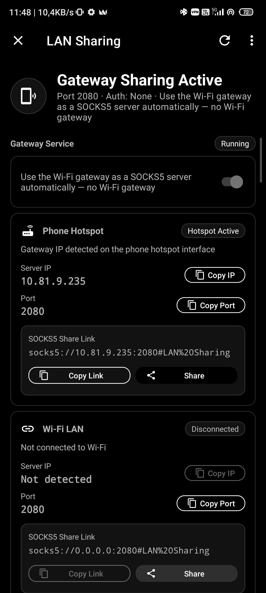

# Throne for Android · `yusa` fork

[🇬🇧 English](README.md) · [🇹🇷 Türkçe](README.tr.md)

> 🔀 **This repository is a fork of [throneproj/ThroneForAndroid](https://github.com/throneproj/ThroneForAndroid).**
> It adds a built-in **LAN Sharing & Hotspot Gateway** suite — share your active VPN tunnel over Hotspot or local Wi-Fi without root, or automatically connect to other Hotspot Gateways with zero manual IP/port entry.

  
  
  
  
  

Android GUI proxy client — powered by the [Sing-box](https://github.com/SagerNet/sing-box) core. Supports Android 7.0 (API 24) and up, plus Android TV.

Documentation: [throneproj.github.io](https://throneproj.github.io)

  

---

## 🚀 Hotspot Gateway & LAN Sharing

Share your active VPN connection across devices over **Phone Hotspot** or **Local Wi-Fi (LAN)** without root permissions, or auto-connect other phones and computers to your shared proxy with zero manual configuration.

  

### 📱 Phone to Phone Sharing
- **Zero-Config Auto Pairing:** If **both phones run Throne** with this feature enabled, the client phone automatically discovers the hotspot gateway and routes traffic through it without typing any IP or port.
- **Other Devices / General Clients:** If the receiving device does not have Throne, you can:
  - Tap **Share Link** or **Copy Link** to send the standard `socks5://[user:pass@]host:port#remark` URI directly to the client.
  - Or tap **Copy IP** and **Copy Port** to manually configure the SOCKS5 proxy in your device's Wi-Fi / Proxy settings.

### 💻 Phone to Computer Sharing (Windows & Linux)
- If your computer runs our desktop application [theyusa/Throne](https://github.com/theyusa/Throne):
  1. Turn on your phone's Hotspot and enable **LAN Sharing** in Throne for Android.
  2. Connect your PC to the phone's Hotspot.
  3. In desktop Throne, navigate to **Settings → Basic Settings → Hotspot Gateway** and toggle it on.
  4. Your PC immediately tunnels through your phone's VPN connection — **no IP or port configuration required!**

### 🌟 Key Capabilities
- 🛡️ **Rootless Operation:** No root required; uses local proxy chaining and inbound socket binding.
- 📡 **Dual Interface Support:** Method A (Phone Hotspot) and Method B (Same Wi-Fi LAN).
- 🔗 **One-Click SOCKS5 Links:** Generates RFC-compliant `socks5://` share links including authentication, optional UDP-over-TCP (UoT), and remark fragments.
- 👥 **Live Connected Client Monitor:** Real-time client device list powered by the internal Clash API (`/connections`) and kernel ARP table fallback, displaying active connections, uploaded/downloaded bytes, and destination domains.
- 🔒 **Optional Authentication:** Optional username and password credentials; masked on export and excluded from backup files.
- 🔁 **Automatic Fallback:** Gracefully falls back to the previous profile if the shared gateway disconnects.

---

## ✨ Throne's Core Features

- 🗂️ **Groups and Subscriptions:** Works seamlessly with desktop Throne: per-group subscription options (filters, clean-up, URL test after update), front / landing proxy, HWID headers, and scheduled updates with change reports.
- 💾 **Cross-Platform Backups:** Backups in `.thrbackup` format, restorable on Android or desktop: save, share, or sync over WebDAV.
- 🧩 **Shared Route Profiles:** Preloaded from [routeprofiles](https://github.com/throneproj/routeprofiles), plus Android-specific rules: per-app proxy, Wi-Fi SSID/BSSID conditions, network types, and metered network detection.
- ⚡ **Auto Selector Profiles:** Continuously ranks and automatically switches between the best servers of one or multiple groups.
- ☁️ **Cloudflare WARP:** Built-in registration (WireGuard or MASQUE identity) and dedicated WARP routing mode.
- 🧪 **Speed & Latency Tests:** URL, IP / country, and latency tests with batch testing (real-time progress, latency histogram, and one-tap connection to fastest node).
- 📊 **Integrated Dashboard:** Real-time sing-box dashboard with live traffic graphs, active connections, and logs.
- ✏️ **Visual JSON Editor:** Advanced editor with sing-box schema validation, auto-completion, and code formatting.
- 📱 **Android System Integration:** Home-screen widgets, Quick Settings tile, and notification bar server switching.
- 📺 **Android TV Support:** Native TV banner, D-pad remote navigation, and quick server switching.

---

## 🔌 Supported Protocols

| | | | |
|---|---|---|---|
| 🧦 SOCKS5 | 🌐 HTTP(S) | 🛡️ Shadowsocks | 🐴 Trojan |
| 💬 VMess | ✉️ VLESS | ⚡ Xray VLESS | 🚀 TUIC |
| 🌀 Hysteria 1/2 | 🔗 AnyTLS | 🪨 Mieru | 🐚 Snell |
| 🦋 NaïveProxy | 🍹 Juicity | 🚇 TrustTunnel | 🎭 ShadowTLS |
| 🔐 WireGuard | 🔐 AmneziaWG | 🎭 MASQUE | 🔑 SSH |
| 🔒 OpenVPN | 🔓 OpenConnect | ➡️ Direct | ⛓️ Chain |
| 🧩 Custom Outbound | ✨ Auto Selector | 📡 DNSTT / VayDNS | 🎯 MasterDNS |

---

## 📥 Subscription Formats

Supports standard share links, various Sing-box JSON representations, and v2rayN link formats, with limited support for Shadowsocks and Clash formats. Only the outbound servers are imported; routing rules are managed independently. Deeplinks are also fully supported ([documentation](https://throneproj.github.io/advanced/deeplinks/)).

---

## 🔄 Daily Upstream Sync

This repository automatically stays in sync with upstream [throneproj/ThroneForAndroid](https://github.com/throneproj/ThroneForAndroid) via [`.github/workflows/sync-upstream.yml`](.github/workflows/sync-upstream.yml).

- 🕒 Runs every day at **03:00 UTC** (and on manual trigger).
- 🔍 Rebase without tags (`--no-tags --empty=drop`) preserves the fork's clean commits on top of upstream `main`.
- 🏷️ Custom Git merge drivers protect fork identity files (`PACKAGE_NAME`, versions, and assets).
- 🚀 Automatic GitHub release dispatch upon detecting new upstream releases.

---

## 🙏 Credits

Built upon the remarkable work of the open-source community:

- **Upstream:** [throneproj/ThroneForAndroid](https://github.com/throneproj/ThroneForAndroid)
- **Cores:** [throneproj/sing-box](https://github.com/throneproj/sing-box) and [throneproj/Xray-core](https://github.com/throneproj/Xray-core)
- **GUI Roots:** [MatsuriDayo/NekoBoxForAndroid](https://github.com/MatsuriDayo/NekoBoxForAndroid), [SagerNet/SagerNet](https://github.com/SagerNet/SagerNet), and [shadowsocks/shadowsocks-android](https://github.com/shadowsocks/shadowsocks-android)
- **Network Tools & NAT Testing:** [eleutherifer/NekoBoxPlus](https://github.com/eleutherifer/NekoBoxPlus) & [ccding/go-stun](https://github.com/ccding/go-stun) (Apache-2.0)
- **Desktop Companion:** [theyusa/Throne](https://github.com/theyusa/Throne) & [throneproj/Throne](https://github.com/throneproj/Throne)

---

## ❓ FAQ

**How does this project differ from NekoBox for Android?**  
Throne replaced the legacy plugin architecture with a unified sing-box and Xray core, shared desktop data models, and `.thrbackup` support. This fork further enhances it with the rootless LAN Sharing and Hotspot Gateway suite.

**How do I share my VPN with my PC without entering IP/Port?**  
Install [theyusa/Throne](https://github.com/theyusa/Throne) on your Windows or Linux PC, connect to your phone's hotspot, and turn on `Settings → Basic Settings → Hotspot Gateway`. The PC connects automatically.

**Where do downloadable route profiles come from?**  
They are fetched directly from the [routeprofiles](https://github.com/throneproj/routeprofiles) repository.

---

## 📜 License

Distributed under the [GNU General Public License v3.0](LICENSE).
