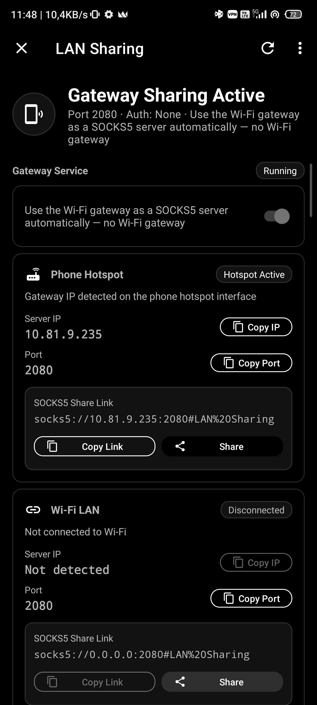

# Throne for Android · `yusa` çatalı (fork)

[🇬🇧 English](README.md) · [🇹🇷 Türkçe](README.tr.md)

> 🔀 **Bu depo [throneproj/ThroneForAndroid](https://github.com/throneproj/ThroneForAndroid) projesinin bir çatalıdır (fork).**
> Dahili **LAN Paylaşımı ve Hotspot Ağ Geçidi (LAN Sharing & Hotspot Gateway)** özelliğini içerir — telefonunuzun aktif VPN bağlantısını **Root gerektirmeden** mobil erişim noktası (Hotspot) veya yerel Wi-Fi ağı üzerinden paylaşmanıza ve diğer Throne istemcilerine hiçbir IP/Port girmeden sıfır yapılandırmayla aktarmanıza olanak tanır.

  
  
  
  
  

Android GUI vektör ve proxy istemcisi — [Sing-box](https://github.com/SagerNet/sing-box) çekirdeği ile güçlendirilmiştir. Android 7.0 (API 24) ve üzerini, ayrıca Android TV'yi destekler.

Resmi Dokümantasyon: [throneproj.github.io](https://throneproj.github.io)

  

---

## 🚀 Hotspot Ağ Geçidi ve LAN Paylaşımı (LAN Sharing)

Telefonunuzun bağlı olduğu VPN tünelini, **Root yetkisi gerektirmeden** mobil erişim noktası (Hotspot) veya aynı yerel Wi-Fi ağı üzerindeki diğer cihazlarla paylaşın.

  

### 📱 Telefondan Telefona Paylaşım
- **Sıfır Yapılandırma ile Otomatik Eşleşme:** Eğer **her iki telefonda da Throne yüklüyse ve bu özellik açıksa**, bağlanan telefon ağ geçidini otomatik olarak keşfeder; hiçbir IP veya port girmeden internetini telefonunuzun VPN'i üzerinden geçirir.
- **Diğer Cihazlar / Genel İstemciler:** Bağlanacak cihazda Throne yoksa:
  - **Linki Paylaş** veya **Linki Kopyala** butonuna dokunarak hazır `socks5://[kullanıcı:parola@]ip:port#açıklama` bağlantı linkini gönderin.
  - Veya cihazın Wi-Fi / Proxy ayarlarına **IP Kopyala** ve **Port Kopyala** butonlarıyla elde ettiğiniz değerleri girin.

### 💻 Telefondan Bilgisayara Paylaşım (Windows & Linux)
- Bilgisayarınızda masaüstü uygulamamız [theyusa/Throne](https://github.com/theyusa/Throne) kullanılıyorsa:
  1. Telefonunuzun Mobil Erişim Noktasını (Hotspot) açın ve Throne uygulamasında **Araçlar → Ağ ve Paylaşım → LAN Paylaşımı** anahtarını etkinleştirin.
  2. Bilgisayarınızı telefonun hotspot ağına bağlayın.
  3. Bilgisayardaki Throne uygulamasında **Settings → Basic Settings → Hotspot Ağ Geçidi (Hotspot Gateway)** ayarını açın.
  4. Bilgisayarınız **hiçbir IP ya da port yazmanıza gerek kalmadan** telefonunuzun VPN tüneli üzerinden güvenle internete çıkar!

### 🌟 Öne Çıkan Özellikler
- 🛡️ **Rootsuz Çalışma:** Cihazda Root gerekmez; yerel soket bağlama ve port yönlendirmesiyle çalışır.
- 📡 **Çift Mod Desteği:** Yöntem A (Telefon Hotspot'ı) ve Yöntem B (Aynı Wi-Fi Ağı).
- 🔗 **Tek Tıkla SOCKS5 Paylaşım Linki:** Kimlik bilgisi, UDP-over-TCP (UoT) desteği ve etiket içeren evrensel RFC uyumlu `socks5://` linki üretir.
- 👥 **Canlı Bağlı Cihaz İzleme:** Dahili Clash API (`/connections`) ve çekirdek ARP tablosu entegrasyonuyla bağlı istemcilerin IP'lerini, aktif bağlantı sayılarını, anlık indirme/yükleme verilerini ve hedef adreslerini listeler.
- 🔒 **İsteğe Bağlı Kimlik Doğrulama:** Kullanıcı adı ve parola koruması; yedek dosyalarına aktarılmaz ve arayüzde maskeli tutulur.
- 🔁 **Otomatik Geri Dönüş (Fallback):** Paylaşılan ağ kesildiğinde veya erişim noktası kapandığında otomatik olarak önceki profile geri döner.

---

## ✨ Throne'un Genel Özellikleri

- 🗂️ **Grup ve Abonelik Yönetimi:** Masaüstü Throne ile birebir uyumlu grup seçenekleri (filtreler, temizleme, güncelleme sonrası URL testi), ön/iniş proxy'si, HWID başlıkları ve zamanlanmış güncellemeler.
- 💾 **Platformlar Arası Yedekleme:** `.thrbackup` biçiminde çift yönlü geri yüklenebilir yedekler: yerel kaydetme, paylaşma veya WebDAV üzerinden eşitleme.
- 🧩 **Ortak Yönlendirme Profilleri:** [routeprofiles](https://github.com/throneproj/routeprofiles) deposundan doğrudan indirilebilir kurallar ve Android'e özgü filtreler (uygulama bazlı tünelleme, Wi-Fi SSID/BSSID koşulları, mobil/tarifeli ağ algılama).
- ⚡ **Otomatik Seçici (Auto Selector) Profilleri:** Gruplardaki en hızlı ve kararlı sunucuları otomatik derecelendirir ve kesintisiz geçiş sağlar.
- ☁️ **Cloudflare WARP Desteği:** Dahili WARP kaydı (WireGuard veya MASQUE kimliği) ve entegre yönlendirme modu.
- 🧪 **Kapsamlı Hız ve Gecikme Testleri:** URL, IP/ülke ve hız testleri; canlı gecikme histogramı ve tek dokunuşla en hızlı sunucuya bağlanma.
- 📊 **Dahili Sing-box Paneli:** Canlı trafik grafiği, aktif bağlantılar ve çekirdek logları.
- ✏️ **Gelişmiş JSON Düzenleyici:** Sing-box şema doğrulaması, otomatik tamamlama ve kod biçimlendirme desteği.
- 📱 **Android Sistem Entegrasyonu:** Ana ekran widget'ları, Hızlı Ayarlar (Quick Settings) kutucuğu ve bildirim çubuğundan sunucu değiştirme.
- 📺 **Android TV Desteği:** TV arayüzü, kumanda (D-pad) ile gezinme ve hızlı sunucu geçişi.

---

## 🔌 Desteklenen Protokoller

| | | | |
|---|---|---|---|
| 🧦 SOCKS5 | 🌐 HTTP(S) | 🛡️ Shadowsocks | 🐴 Trojan |
| 💬 VMess | ✉️ VLESS | ⚡ Xray VLESS | 🚀 TUIC |
| 🌀 Hysteria 1/2 | 🔗 AnyTLS | 🪨 Mieru | 🐚 Snell |
| 🦋 NaïveProxy | 🍹 Juicity | 🚇 TrustTunnel | 🎭 ShadowTLS |
| 🔐 WireGuard | 🔐 AmneziaWG | 🎭 MASQUE | 🔑 SSH |
| 🔒 OpenVPN | 🔓 OpenConnect | ➡️ Direct | ⛓️ Chain |
| 🧩 Özel Çıkış (Custom) | ✨ Otomatik Seçici | | |

---

## 📥 Abonelik Formatları

Standart paylaşım linkleri, Sing-box JSON yapılandırmaları ve v2rayN bağlantı biçimleri desteklenir; ayrıca Shadowsocks ve Clash formatları için temel destek sunulur. Yalnızca sunucu çıkışları içe aktarılır, yönlendirme kuralları bağımsız yönetilir. Deeplink desteği de mevcuttur ([dokümantasyon](https://throneproj.github.io/advanced/deeplinks/)).

---

## 🔄 Günlük Upstream Senkronizasyonu

Bu depo, [`.github/workflows/sync-upstream.yml`](.github/workflows/sync-upstream.yml) aracılığıyla ana kaynak ([throneproj/ThroneForAndroid](https://github.com/throneproj/ThroneForAndroid)) ile otomatik olarak senkronize kalır.

- 🕒 Her gün **03:00 UTC** saatinde (veya manuel tetikleme ile) çalışır.
- 🔍 Tag çakışmalarını önleyen rebase (`--no-tags --empty=drop`) ile fork commit'lerini güncel upstream üzerine taşır.
- 🏷️ Özel Git merge sürücüleri çatalın kimlik dosyalarını (`PACKAGE_NAME`, sürümler ve varlıklar) korur.
- 🚀 Yeni bir upstream sürümü algılandığında otomatik release iş akışını başlatır.

---

## 🙏 Teşekkür ve Kaynaklar

Açık kaynak dünyasının katkılarıyla inşa edilmiştir:

- **Upstream:** [throneproj/ThroneForAndroid](https://github.com/throneproj/ThroneForAndroid)
- **Çekirdekler:** [throneproj/sing-box](https://github.com/throneproj/sing-box) ve [throneproj/Xray-core](https://github.com/throneproj/Xray-core)
- **GUI Kökleri:** [MatsuriDayo/NekoBoxForAndroid](https://github.com/MatsuriDayo/NekoBoxForAndroid), [SagerNet/SagerNet](https://github.com/SagerNet/SagerNet) ve [shadowsocks/shadowsocks-android](https://github.com/shadowsocks/shadowsocks-android)
- **Masaüstü Eşi:** [theyusa/Throne](https://github.com/theyusa/Throne) & [throneproj/Throne](https://github.com/throneproj/Throne)

---

## ❓ Sıkça Sorulan Sorular (SSS)

**NekoBox for Android'den farkı nedir?**  
Throne, eski eklenti (plugin) mimarisini kaldırarak masaüstü Throne ile paylaşılan tek bir sing-box ve Xray çekirdeğine, ortak veri modellerine ve `.thrbackup` desteğine geçmiştir. Bu fork ise bunların üzerine rootsuz LAN Paylaşımı ve Hotspot Ağ Geçidi paketini ekler.

**Bilgisayarımla IP/Port girmeden nasıl VPN paylaşırım?**  
Windows veya Linux bilgisayarınıza [theyusa/Throne](https://github.com/theyusa/Throne) masaüstü uygulamasını kurun, bilgisayarınızı telefonun hotspot'una bağlayın ve masaüstünde `Settings → Basic Settings → Hotspot Ağ Geçidi` ayarını açın. Bilgisayarınız otomatik bağlanacaktır.

**İndirilebilir yönlendirme profilleri nereden geliyor?**  
Doğrudan masaüstü Throne'un da kullandığı [routeprofiles](https://github.com/throneproj/routeprofiles) deposundan alınmaktadır.

---

## 📜 Lisans

[GNU General Public License v3.0](LICENSE) altında dağıtılmaktadır.
